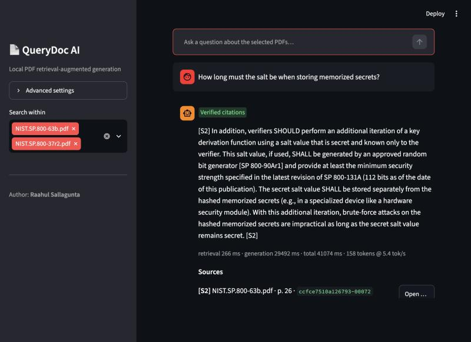
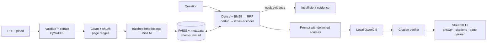
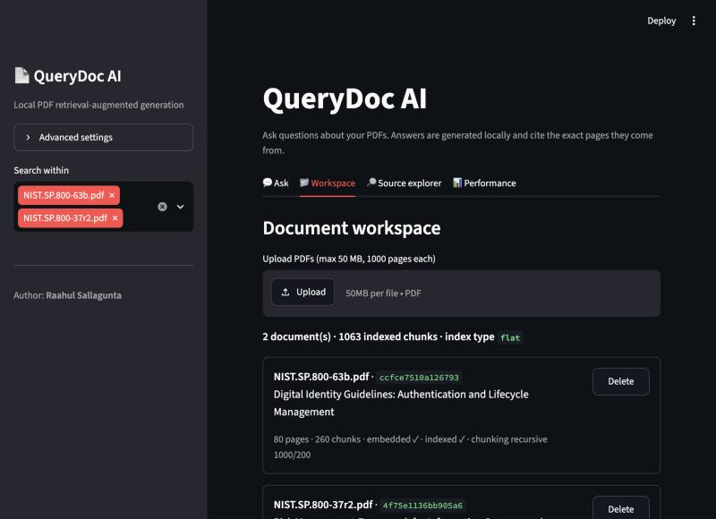
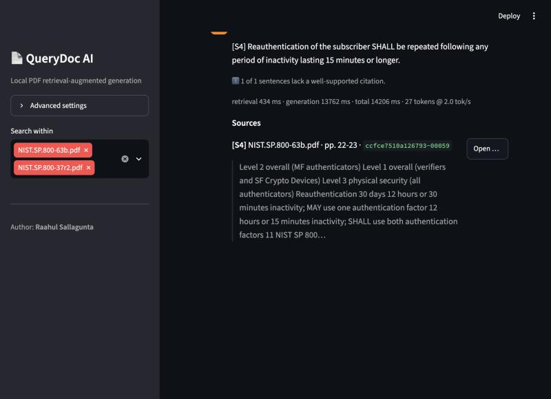
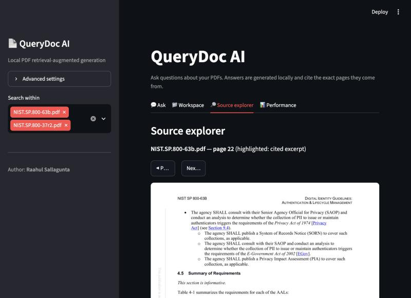
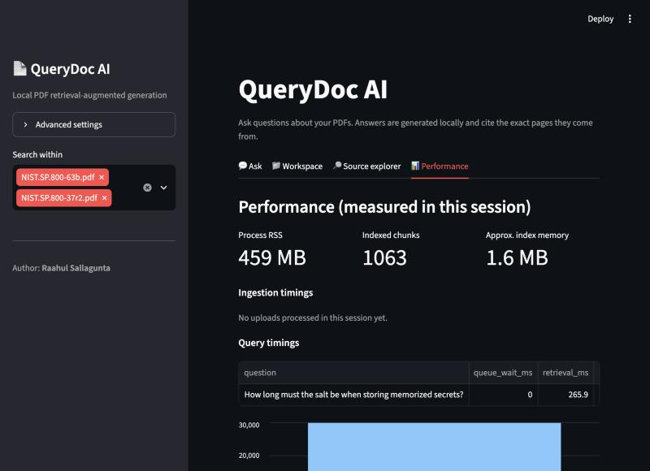

# QueryDoc AI

**Local PDF Retrieval-Augmented Generation System** · Author: **Raahul Sallagunta**

QueryDoc AI is a local-first PDF intelligence system that uses retrieval-augmented generation to transform long documents into searchable knowledge, retrieve semantically relevant evidence, and generate grounded answers with verifiable page-level citations.



## Features

- **PDF ingestion** with PyMuPDF: validation (type, size, corruption, encryption, page limit), page-level text, blank/scanned-page detection, rotated-watermark filtering, duplicate detection by content hash, optional OCR hook.
- **Page-tracked chunking**: recursive (LangChain), fixed or sentence strategies; chunks that cross pages report their full page range.
- **Batched embeddings** (SentenceTransformers `all-MiniLM-L6-v2`) with a content-hash cache stored without pickle.
- **FAISS vector search** (exact `IndexFlatIP`, optional HNSW) with per-document filtering, deletion, and atomic checksummed persistence.
- **Hybrid retrieval**: dense + BM25 with reciprocal rank fusion, overlap de-duplication, and cross-encoder reranking.
- **On-device generation** with Hugging Face Transformers (`Qwen/Qwen2.5-1.5B-Instruct`, Apache-2.0) on Apple GPU, CUDA or CPU, plus a retrieval-only fallback.
- **Verified citations**: every `[S#]` tag is checked against the retrieved chunks and the index, scored for support, and shown with a status badge and a clickable rendered page.
- **Safety**: an insufficient-evidence gate, delimited untrusted sources, prompt-injection redaction, and no pickle anywhere.
- **Concurrency controls**: readers–writer index lock, shared GPU lock, and bounded admission control for generation.
- **Benchmarks and acceptance script** with raw JSON/CSV evidence and charts.

## Architecture



Details: [docs/ARCHITECTURE.md](docs/ARCHITECTURE.md).

## Technology stack

Python 3.12 · LangChain (text splitters, documents, prompts) · FAISS · SentenceTransformers · Hugging Face Transformers · PyTorch (CPU/MPS/CUDA) · PyMuPDF · rank-bm25 · Streamlit · NumPy · Pandas · pydantic-settings · pytest · Ruff · mypy. Rationale: [docs/TECH_STACK_DECISIONS.md](docs/TECH_STACK_DECISIONS.md).

## Installation

```bash
git clone <repo-url> querydoc-ai && cd querydoc-ai
uv venv -p 3.12 .venv && source .venv/bin/activate      # or python -m venv .venv
uv pip install -e ".[dev]"                               # or pip install -e ".[dev]"
```

The models (~3.2 GB in total) download on first use into `~/.cache/huggingface`; after that the app runs offline. If the project lives in an iCloud-synced folder (Desktop/Documents), keep the environment in a `*.nosync` folder. See [TROUBLESHOOTING #2](docs/TROUBLESHOOTING.md).

## Usage

```bash
streamlit run app/main.py
```

Open http://localhost:8501. In **Workspace**, upload PDFs. In **Ask**, ask questions; use **Open page** on a citation to see the page rendered with the excerpt highlighted. **Source explorer** shows retrieved passages and scores, **Performance** shows live timings, and **Advanced settings** (sidebar) tunes chunking, retrieval and generation. Configuration via environment variables: [.env.example](.env.example).

## Screenshots (captured from the running app)

| Workspace | Partially verified answer | Cited page | Performance |
|---|---|---|---|
|  |  |  |  |

## Benchmarks (measured on an Apple M3 Pro laptop, 18 GB)

| What | Result | Target | Verdict |
|---|---|---|---|
| Retrieval quality, nDCG@5 (held-out questions) | 0.578 → 0.831, **+43.8%** (95% CI +17…+91%); +36.7% on all 63 questions | +40% | PASS on held-out split |
| Warm retrieval latency, 100+ page PDFs, reranker on GPU | p50 ≤ 80 ms, **p95 ≤ 129 ms** | < 300 ms | PASS |
| Same, reranker on CPU only | p95 541–556 ms on real documents | < 300 ms | **FAIL** |
| Full generated answer (Qwen2.5-1.5B) | p50 1.9 s, p95 4.4 s | — | not sub-300 ms |
| Embedding peak memory, bounded batches vs unbatched | 4,502 → 970 MB, **−78.5%** (no gain vs library default) | −35% | PASS |
| Concurrent retrieval, 1–20 users | 380 requests, **0 errors**, ~12 req/s (does not scale) | tested | PASS |
| Generated-answer accuracy (held-out, keyword) | 84%; 97% with a verified citation | — | info |

Full report: [docs/PERFORMANCE_REPORT.md](docs/PERFORMANCE_REPORT.md) · experiments and failed approaches: [docs/EXPERIMENTS.md](docs/EXPERIMENTS.md) · claim-by-claim evidence: [docs/RESUME_CLAIM_VALIDATION.md](docs/RESUME_CLAIM_VALIDATION.md).

Reproduce: `python scripts/download_corpus.py && python benchmarks/run_all_benchmarks.py && python scripts/acceptance.py`.

## Testing

```bash
pytest                    # 97 tests: unit, integration, security, performance, LLM end-to-end
pytest -m "not llm"       # what CI runs
ruff check src app benchmarks scripts tests && mypy
python scripts/check_streamlit.py
```

See [docs/TESTING_AND_VALIDATION.md](docs/TESTING_AND_VALIDATION.md). Acceptance table: `results/acceptance/ACCEPTANCE.md`.

## Repository structure

```text
querydoc-ai/
├── app/                    Streamlit UI (main.py, components/viewer.py)
├── src/querydoc/
│   ├── config.py           settings, device resolution, local-first loading
│   ├── devices.py          shared GPU lock
│   ├── ingestion/          PDF validation/extraction, text cleaning
│   ├── chunking/           page-tracked chunking strategies
│   ├── embeddings/         batched SentenceTransformer embedder + cache
│   ├── vectorstore/        FAISS store, RW lock, persistence
│   ├── retrieval/          hybrid retrieval, dedup, MMR, reranker
│   ├── generation/         prompts (+ injection redaction), local LLM
│   ├── citations/          citation verification and attribution
│   ├── evaluation/         relevance metrics, synthetic PDFs
│   └── services/           QueryDocService, registry, admission control
├── benchmarks/             benchmark scripts + chart generation
├── eval/questions.json     63 labelled questions + 6 unanswerable
├── tests/                  unit / integration / e2e / performance
├── scripts/                corpus download, acceptance, Streamlit launch check
├── results/                raw benchmark evidence (JSON/CSV), acceptance table
├── docs/                   documentation and images
└── .github/workflows/ci.yml
```

## Documentation

[Complete guide](docs/PROJECT_COMPLETE_GUIDE.md) · [Architecture](docs/ARCHITECTURE.md) · [Tech stack decisions](docs/TECH_STACK_DECISIONS.md) · [RAG internals](docs/RAG_INTERNALS.md) · [Performance report](docs/PERFORMANCE_REPORT.md) · [Experiments](docs/EXPERIMENTS.md) · [Testing](docs/TESTING_AND_VALIDATION.md) · [Troubleshooting](docs/TROUBLESHOOTING.md) · [Interview preparation](docs/INTERVIEW_PREPARATION.md) · [Resume claim validation](docs/RESUME_CLAIM_VALIDATION.md)

## Known limitations

- Not production-ready: no authentication or per-user isolation; single process; do not expose beyond localhost.
- Sub-300 ms applies to **retrieval with a GPU reranker** only; CPU-only retrieval and full answers are slower.
- Retrieval throughput is capped (~12 req/s) by one cross-encoder; generation is serialised, and timeouts were observed at 10–20 concurrent generation users under memory pressure.
- Citation verification is lexical: it checks grounding, not whether the answer addresses the question.
- Prompt-injection redaction is heuristic.
- The evaluation set is small (63 questions, 4 documents) and was labelled with AI assistance.
- OCR for scanned PDFs is an untested optional extension.

## License

**No license has been selected yet.** Choosing one is the author's decision; until a `LICENSE` file is added, all rights are reserved by the author. Third-party components keep their own licenses: PyMuPDF is AGPL-3.0 (or commercial), FAISS is MIT, the Qwen2.5 models are Apache-2.0, all-MiniLM-L6-v2 and ms-marco-MiniLM-L-6-v2 are Apache-2.0, and the NIST evaluation documents are U.S. government works.
