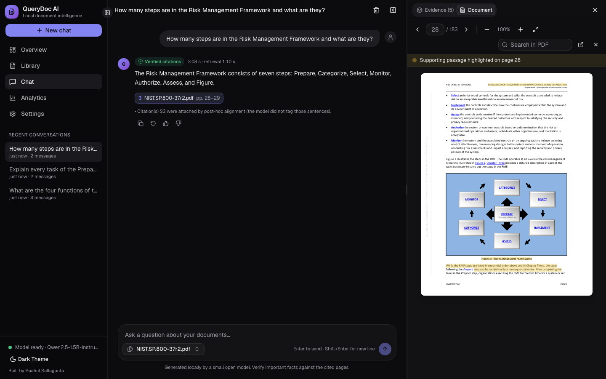
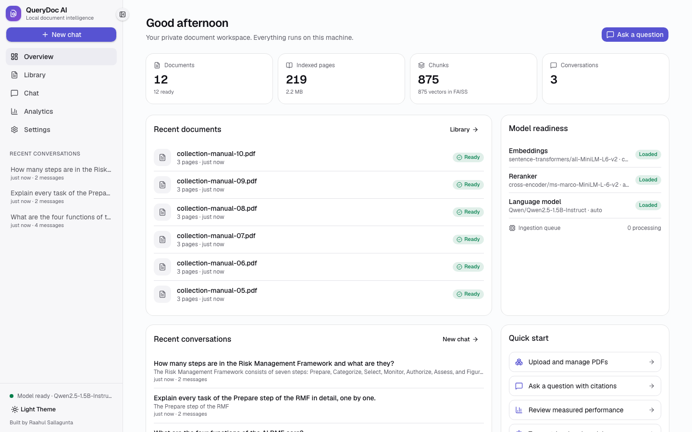
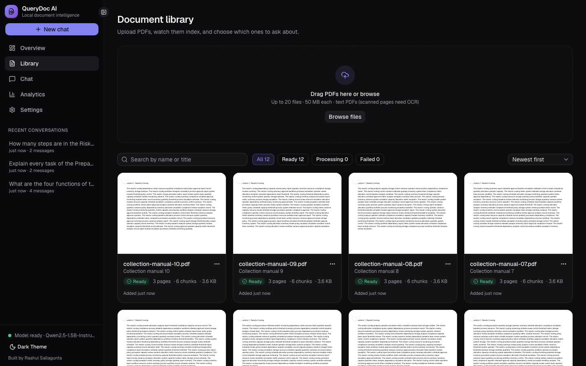
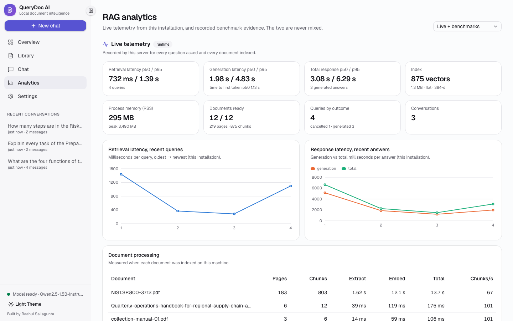
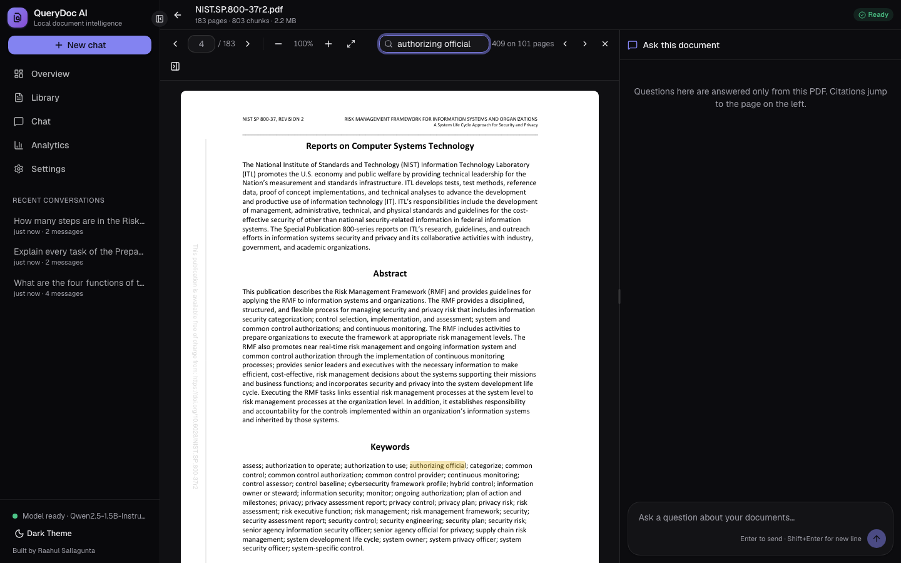
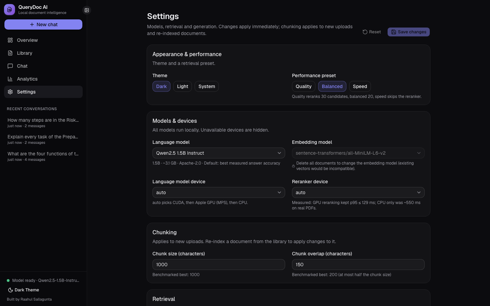
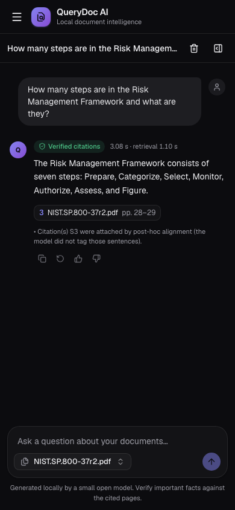
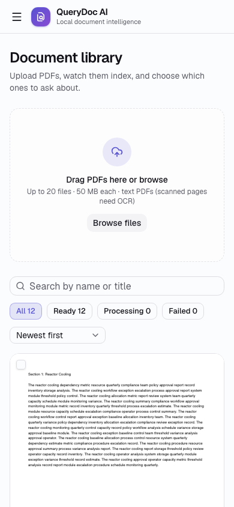
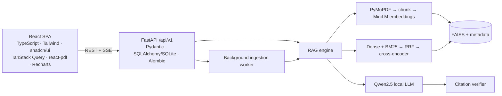

# QueryDoc AI

**Local PDF Retrieval-Augmented Generation System** · Author: **Raahul Sallagunta**

QueryDoc AI is a local-first PDF intelligence system that uses retrieval-augmented generation to transform long documents into searchable knowledge, retrieve semantically relevant evidence, and generate grounded answers with verifiable page-level citations.



## Features

- **Document library** — drag-and-drop multi-PDF upload with client and server validation, background indexing with live progress, real first-page thumbnails, search, status filters, re-index and delete.
- **AI chat workspace** — three-panel layout (navigation and history · conversation · evidence) with **streamed answers** from a local LLM, inline citation chips, copy / regenerate / feedback, Stop, follow-up questions, per-conversation document scope, saved conversations.
- **Verified citations** — every `[S#]` is checked against the retrieved chunks, the selected documents and the index; claims are scored for support; answers carry a status badge (*Verified*, *Partially verified*, *Could not verify*, *Insufficient evidence*).
- **Interactive PDF viewer** — PDF.js rendering, page navigation, zoom, in-document search, citation-linked navigation, and highlights placed only on text that really matches the cited passage. A side-by-side "ask this document" chat sits next to the PDF.
- **RAG analytics** — live telemetry from this installation (retrieval, generation and total p50/p95, processing times, index size, memory) shown separately from recorded benchmark evidence (relevance, latency on GPU/CPU, memory, concurrency, generation).
- **Settings** — models, devices, chunking, top-k, hybrid search, reranking, tokens, temperature, theme and performance presets, validated on both client and server.
- **RAG engine** — PyMuPDF extraction (rotated-watermark filtering, soft-wrap reflow, scanned-page detection), LangChain recursive chunking with page ranges, batched SentenceTransformer embeddings, FAISS with checksummed persistence, BM25 + dense fusion, cross-encoder reranking, Qwen2.5 on the Apple GPU / CUDA / CPU.
- **Safety and reliability** — upload limits and validation, path-traversal-safe storage, scoped retrieval, prompt-injection delimiting and redaction, bounded generation queue with timeouts, cancellation on disconnect, no pickle anywhere, structured JSON logs.

## Screenshots (captured from the running app by Playwright)

| Overview (light) | Library (dark) | Analytics (light) |
|---|---|---|
|  |  |  |

| Viewer + document chat | Settings | Mobile chat | Mobile library (light) |
|---|---|---|---|
|  |  |  |  |

All 30+ screenshots (desktop, tablet, mobile × dark, light, plus empty/loading/error states) are in [`docs/images/ui/`](docs/images/ui/).

## Architecture



Details: [docs/ARCHITECTURE.md](docs/ARCHITECTURE.md) · API reference: [docs/API.md](docs/API.md) (also live at `/api/docs`).

## Technology stack

**Frontend:** React 19, TypeScript 7, Vite 8, Tailwind CSS v4, shadcn/ui, Radix UI, Lucide, Motion, TanStack Query, React Router, react-pdf (PDF.js), Recharts, Zod, React Hook Form.
**Backend:** Python 3.12, FastAPI, Pydantic, Uvicorn, SQLAlchemy 2, SQLite, Alembic, Server-Sent Events, structured JSON logging.
**AI / RAG:** LangChain (text splitters, documents, prompts), PyMuPDF, SentenceTransformers (all-MiniLM-L6-v2, ms-marco cross-encoder), FAISS, Hugging Face Transformers, PyTorch (MPS/CUDA/CPU), Qwen2.5-1.5B-Instruct.
**Testing:** pytest, HTTPX, Vitest, React Testing Library, vitest-axe, Playwright, Ruff, mypy, TypeScript.
Why each was chosen: [docs/TECH_STACK_DECISIONS.md](docs/TECH_STACK_DECISIONS.md).

## Quick start

Requirements: macOS (Apple silicon recommended) or Linux, Python 3.12, Node 22 (see `frontend/.nvmrc`), ~6 GB free disk, 16 GB RAM recommended.

```bash
git clone <repo-url> querydoc-ai && cd querydoc-ai
./scripts/setup.sh --with-models     # venv + backend deps, npm ci, DB migration, model download (~3.3 GB, once)
./scripts/dev.sh                     # API http://127.0.0.1:8000/api/docs + UI http://127.0.0.1:5173
```

Production-style local run (one process serves the built UI and the API on :8000):

```bash
./scripts/start_prod.sh
```

Configuration: environment variables prefixed `QUERYDOC_` (see [.env.example](.env.example)). Data lives in `data/workspace/` (SQLite database, FAISS index, stored PDFs). Docker is not provided because containers on macOS cannot use the Apple GPU.

> If the project sits in an iCloud-synced folder (Desktop/Documents) on a nearly full disk, macOS may evict files; keep it in a `*.nosync` folder — see [TROUBLESHOOTING](docs/TROUBLESHOOTING.md).

## Usage

1. **Library** → drop PDFs. Each card shows real progress (extracting → embedding) and becomes *Ready*.
2. **Chat** → choose documents in the scope picker (or all), ask a question, watch the answer stream in. The evidence panel shows retrieved passages with scores and pages.
3. Click a **citation** → the PDF opens at the cited page with the supporting passage highlighted. Ask follow-ups; conversations are saved and listed in the sidebar.
4. **Analytics** → live latencies and processing times from your own use, plus the recorded benchmark evidence. **Settings** → tune retrieval and models.

## Measured results (Apple M3 Pro laptop, 18 GB, under heavy background load)

| What | Result | Target | Verdict |
|---|---|---|---|
| Retrieval quality, nDCG@5 (held-out questions) | 0.578 → 0.831, **+43.8%** (95% CI +17…+91%); +36.7% on all 63 | +40% | PASS on held-out split |
| Warm retrieval, 100+ page PDFs, reranker on GPU | p50 ≤ 80 ms, **p95 ≤ 129 ms** | < 300 ms | PASS |
| Same, measured through the HTTP API (SSE) | evidence p50 **100 ms**, p95 **269 ms** | < 300 ms | PASS |
| Same, reranker on CPU only | p95 541–556 ms on real documents | < 300 ms | **FAIL** |
| Full generated answer (Qwen2.5-1.5B, via API) | first token p50 1.08 s; total p50 2.0 s, p95 4.7 s | — | not sub-300 ms |
| Embedding peak memory, bounded batches vs unbatched | 4,502 → 970 MB, **−78.5%** (no gain vs library default) | −35% | PASS |
| Concurrent retrieval, 1–20 users | 380 requests, **0 errors**, ~12 req/s (does not scale) | tested | PASS |
| 183-page PDF, upload → ready via the API | 12.9 s | — | info |
| Answer accuracy (held-out, keyword) | 84%; 97% with a verified citation | — | info |

Full report: [docs/PERFORMANCE_REPORT.md](docs/PERFORMANCE_REPORT.md) · experiments and failed approaches: [docs/EXPERIMENTS.md](docs/EXPERIMENTS.md) · claim-by-claim evidence: [docs/RESUME_CLAIM_VALIDATION.md](docs/RESUME_CLAIM_VALIDATION.md) · acceptance table: `results/acceptance/ACCEPTANCE.md`.

## Testing

```bash
./scripts/test_all.sh                # everything below, JUnit evidence in results/tests/
cd backend && pytest                 # 119 tests: engine unit/integration/e2e/performance + 22 API tests
cd frontend && npx vitest run        # 22 component/unit tests incl. axe accessibility checks
cd frontend && npx playwright test   # 22 tests in a real browser against a fresh real stack (10 functional + 12 visual)
python scripts/check_app.py          # production-style launch check
python scripts/acceptance.py         # PASS/FAIL table from evidence files
```

See [docs/TESTING_AND_VALIDATION.md](docs/TESTING_AND_VALIDATION.md).

## Repository structure

```text
querydoc-ai/
├── frontend/                 React + TypeScript app
│   ├── src/app/              providers, router
│   ├── src/components/       app shell, shared components, shadcn/ui primitives (ui/)
│   ├── src/features/         chat, documents, viewer, analytics, settings
│   ├── src/pages/            route pages
│   ├── src/hooks/ lib/ services/ types/ styles in index.css
│   └── e2e/                  Playwright functional + visual specs
├── backend/
│   ├── app/                  FastAPI: api/v1, core, db, models, schemas, services, rag (engine bridge), workers
│   ├── querydoc/             RAG engine: ingestion, chunking, embeddings, vectorstore, retrieval, generation, citations, evaluation
│   ├── alembic/              database migrations
│   └── tests/                unit, integration, e2e, performance, api
├── benchmarks/               benchmark scripts + chart generation
├── eval/questions.json       63 labelled questions + 6 unanswerable
├── scripts/                  setup, dev, prod, tests, launch check, acceptance, corpus/model download
├── results/                  raw benchmark evidence (JSON/CSV), test reports, acceptance table
└── docs/                     documentation and screenshots
```

## Documentation

[Complete guide](docs/PROJECT_COMPLETE_GUIDE.md) · [Architecture](docs/ARCHITECTURE.md) · [API](docs/API.md) · [Tech stack decisions](docs/TECH_STACK_DECISIONS.md) · [RAG internals](docs/RAG_INTERNALS.md) · [Performance report](docs/PERFORMANCE_REPORT.md) · [Experiments](docs/EXPERIMENTS.md) · [Testing](docs/TESTING_AND_VALIDATION.md) · [Troubleshooting](docs/TROUBLESHOOTING.md) · [Interview preparation](docs/INTERVIEW_PREPARATION.md) · [Resume claim validation](docs/RESUME_CLAIM_VALIDATION.md) · [Implementation status](IMPLEMENTATION_STATUS.md)

## Known limitations

- **Local single-user mode only:** no authentication, authorisation or TLS. Do not expose the server beyond localhost; this is not a secured multi-tenant deployment.
- Sub-300 ms applies to **retrieval with the reranker on the GPU**; CPU-only retrieval and full generated answers are slower.
- Retrieval throughput is capped (~12 req/s) by one cross-encoder; generation is serialised; timeouts were observed at 10–20 concurrent generation users under memory pressure.
- Citation verification is lexical: it checks grounding, not whether an answer fully addresses the question; a small local model can be grounded yet off-target.
- Prompt-injection redaction is heuristic.
- The relevance benchmark is small (63 questions, 4 documents) and AI-assisted.
- OCR, CUDA, Linux/Windows and non-Chromium browsers were not tested.

## License

**No license has been selected yet.** Choosing one is the author's decision; until a `LICENSE` file is added, all rights are reserved by the author. Third-party components keep their own licenses — notably PyMuPDF is AGPL-3.0 (or commercial), FAISS MIT, Qwen2.5 and the MiniLM models Apache-2.0, shadcn/ui and Radix MIT, react-pdf/PDF.js MIT/Apache-2.0; the NIST evaluation documents are U.S. government works.
