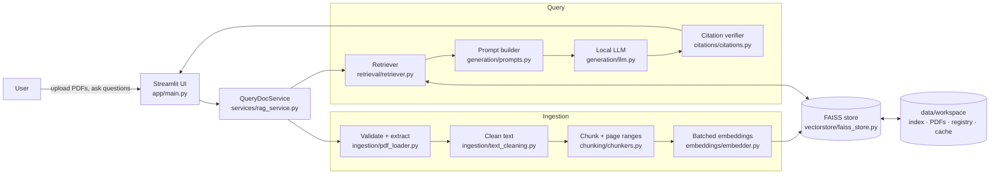
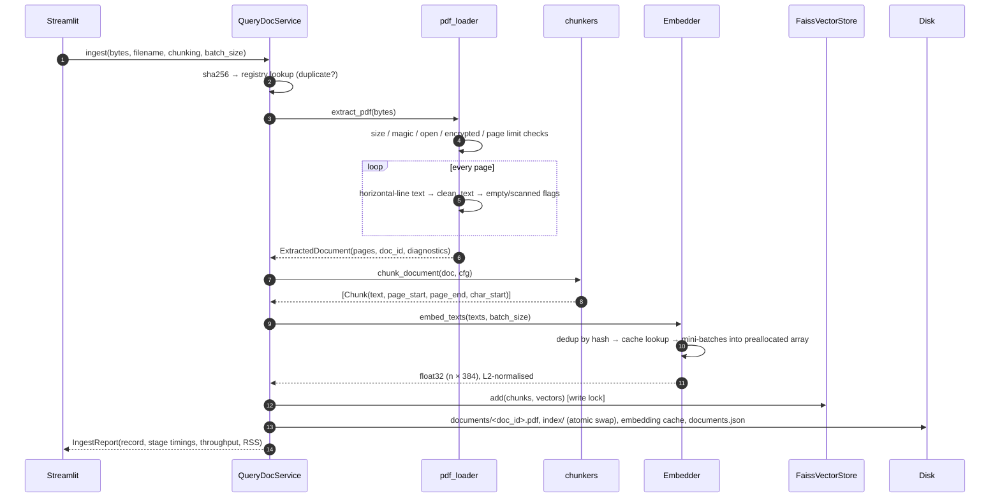
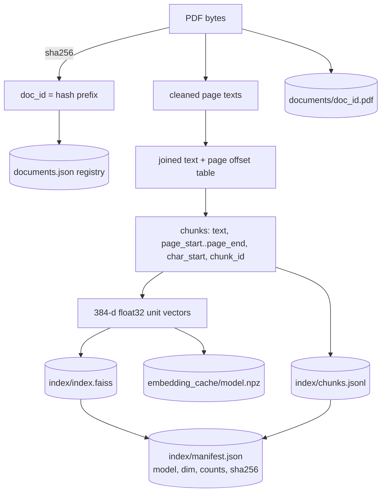
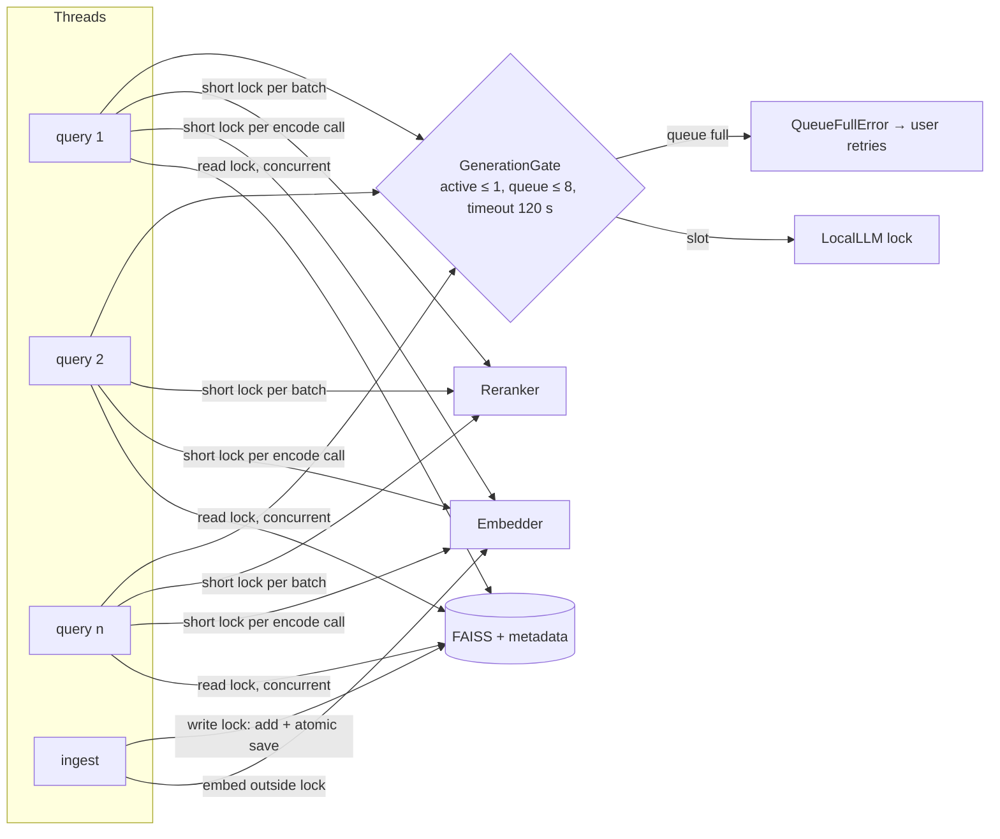

# Architecture

**Project:** QueryDoc AI · **Author:** Raahul Sallagunta

QueryDoc AI is a single-process, local-first application. All models run on the
user's machine; there is no network dependency after the one-time model download.

## 1. High-level view



## 2. Components and responsibilities

| Module | Responsibility | Key types / functions |
|---|---|---|
| `config.py` | Typed settings from env/`.env` (`QUERYDOC_*`), device resolution | `Settings`, `get_settings`, `resolve_device` |
| `ingestion/pdf_loader.py` | Validate PDF bytes, extract per-page text, detect blank/scanned pages, stable ids | `extract_pdf`, `ExtractedDocument`, `PageText`, `sanitize_filename` |
| `ingestion/text_cleaning.py` | Unicode/whitespace normalisation, de-hyphenation, soft-wrap reflow | `clean_text` |
| `chunking/chunkers.py` | Fixed / recursive / sentence chunking with page-range metadata | `chunk_document`, `ChunkingConfig`, `Chunk`, `joined_text` |
| `embeddings/embedder.py` | SentenceTransformer wrapper: batched, normalised, cached, thread-safe | `Embedder`, `EmbeddingCache`, `EmbeddingStats` |
| `vectorstore/faiss_store.py` | FAISS index + metadata, filtering, delete, atomic checksummed persistence, RW lock | `FaissVectorStore`, `SearchHit`, `RWLock` |
| `retrieval/retriever.py` | Dense search, BM25 + RRF, dedup, MMR, cross-encoder rerank, per-stage timings | `Retriever`, `RetrievalConfig`, `BM25Index`, `Reranker` |
| `generation/prompts.py` | Grounding rules, delimited untrusted sources, token budget | `build_prompt`, `SYSTEM_PROMPT` |
| `generation/llm.py` | Load HF causal LM once, stream/generate, OOM handling | `LocalLLM`, `GenerationParams`, `GenerationResult` |
| `citations/citations.py` | Map `[S#]` tags to chunks, reject invalid ones, score support, status | `verify_answer`, `CitationReport` |
| `services/rag_service.py` | Orchestration, resource lifecycle, insufficient-evidence gate, fallbacks | `QueryDocService`, `RAGResponse`, `IngestReport` |
| `services/concurrency.py` | Admission control for generation | `GenerationGate` |
| `services/registry.py` | Persistent document registry (JSON) | `DocumentRegistry`, `DocumentRecord` |
| `evaluation/relevance.py` | Evidence-span relevance judgments and IR metrics | `GroundTruth`, `score_ranking`, `bootstrap_ci` |
| `evaluation/synthetic.py` | Deterministic PDFs for tests and scale benchmarks | `make_synthetic_pdf` |
| `app/main.py` | Streamlit UI (workspace, chat, source explorer, performance) | `get_service` (`st.cache_resource`) |

## 3. PDF ingestion flow



## 4. Question-answering flow

```mermaid
sequenceDiagram
    autonumber
    participant UI as Streamlit
    participant S as QueryDocService
    participant R as Retriever
    participant F as FAISS
    participant B as BM25
    participant X as CrossEncoder
    participant G as GenerationGate
    participant M as LocalLLM
    participant V as verify_answer
    UI->>S: answer(question, retrieval cfg, generation params)
    S->>R: retrieve(question)
    R->>R: clean query, embed (MiniLM)
    R->>F: top fetch_k by inner product (doc filter via IDSelector)  [read lock]
    R->>B: top fetch_k by BM25
    R->>R: Reciprocal Rank Fusion → dedup overlapping chunks
    R->>X: score top rerank_k (query, passage) pairs
    R-->>S: top_k chunks + per-stage timings + max dense score
    alt max dense score < min_relevance_score
        S-->>UI: "insufficient evidence" (LLM not called)
    else LLM unavailable
        S-->>UI: retrieval-only response with passages
    else
        S->>G: acquire slot (bounded queue, timeout)
        S->>M: prompt = rules + <source id=S1..Sk> + question
        Note over S,M: instruction-like sentences in sources are redacted first
        M-->>S: answer text with [S#] tags (+ TTFT, tokens/s)
        S->>V: verify tags ⊆ prompt sources ∩ allowed docs ∩ index; support per sentence
        V-->>S: cleaned answer, citations (file, pages, chunk, excerpt), status
        S-->>UI: RAGResponse(answer, status, citations, timings)
    end
    UI->>UI: "Open page" → render PDF page with highlighted excerpt
```

## 5. Data flow and storage



`data/workspace/` (configurable via `QUERYDOC_DATA_DIR`):

| Path | Format | Purpose | Safety |
|---|---|---|---|
| `documents.json` | JSON | registry: filename, title, hash, pages, chunks, chunking config, timings | atomic replace |
| `documents/<doc_id>.pdf` | PDF | page rendering for citations | path built from validated hex id only |
| `index/index.faiss` | FAISS binary | vectors + ids | SHA-256 in manifest |
| `index/chunks.jsonl` | JSON lines | chunk metadata by vector id | SHA-256 in manifest |
| `index/manifest.json` | JSON | model name, dim, index type, counts, checksums | validated before use |
| `embedding_cache/<model>.npz` | NumPy archive | text-hash → vector | loaded with `allow_pickle=False`, model/dim checked |

No pickle files are written or read anywhere.

## 6. Model loading and lifecycle

| Model | Size | Loaded | Device | Lifetime |
|---|---|---|---|---|
| all-MiniLM-L6-v2 (embedder) | ~90 MB | at service start | CPU (configurable) | process |
| ms-marco-MiniLM-L-6-v2 (reranker) | ~90 MB | first reranked query | `auto` (MPS/CUDA/CPU) | process |
| Qwen2.5-1.5B-Instruct (LLM, default) | ~3 GB fp16 | first generated answer | `auto` | process |

All three load **local-first** (`config.load_local_first`: `local_files_only=True`, network only if not cached — a stalled Hub request once blocked app start-up). `QueryDocService` owns all three; Streamlit keeps one service per server process via
`@st.cache_resource`, so no rerun or new browser session reloads a model. If the
LLM fails to load (missing weights offline, out of memory), the failure is
remembered and every answer degrades to retrieval-only with a visible note.

## 7. Concurrency architecture



- **Index:** writer-preferring readers–writer lock. FAISS searches run in parallel; an add/delete waits for in-flight searches and blocks new ones briefly. Saves write a temp directory then `os.replace`, so a crash mid-save never corrupts the live index.
- **Tokenizers/models:** HF fast tokenizers raise "Already borrowed" if used from two threads at once, so each `encode`/`predict` call holds a short lock. Native kernels release the GIL.
- **Generation:** one model instance runs one `generate()` at a time. A generating request takes its `GenerationGate` slot *before* retrieval, so the queue bound (8) and timeout (120 s) cover the whole request; overflow fails fast with `QueueFullError`. Retrieval-only requests are not gated.
- **Shared GPU:** Apple MPS aborts the process when two threads submit work concurrently (observed: reranker + LLM). `querydoc/devices.py::device_lock` is one re-entrant lock per accelerator that the embedder, reranker and LLM all take around forward passes. Consequence: during a generation, reranking for other requests waits.
- **Ingestion vs queries:** embedding (the slow part) runs outside any lock; only the in-memory add and the save are exclusive.

## 8. Deployment shape and its limits

Single machine, single process, local disk. This is the right shape for a personal
or small-team tool; it is not multi-tenant (no auth, one shared index), and it does
not scale horizontally. See `docs/PROJECT_COMPLETE_GUIDE.md` Part H for the path to
a FastAPI service with per-user indexes and an external vector database.
