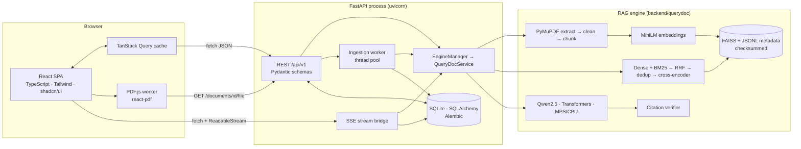
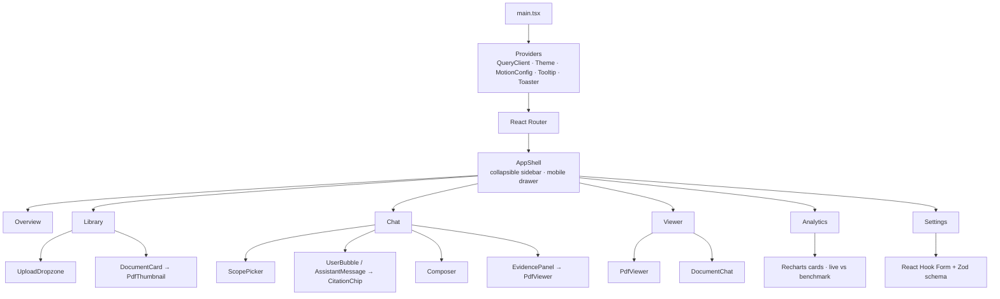
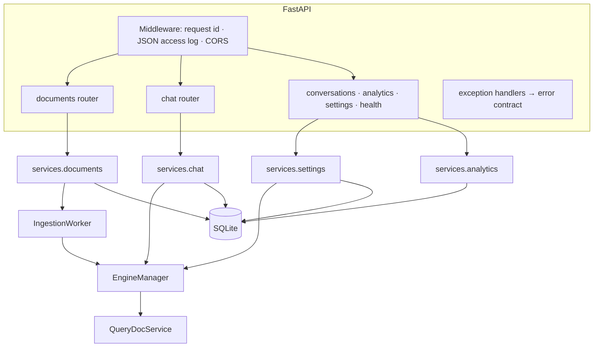
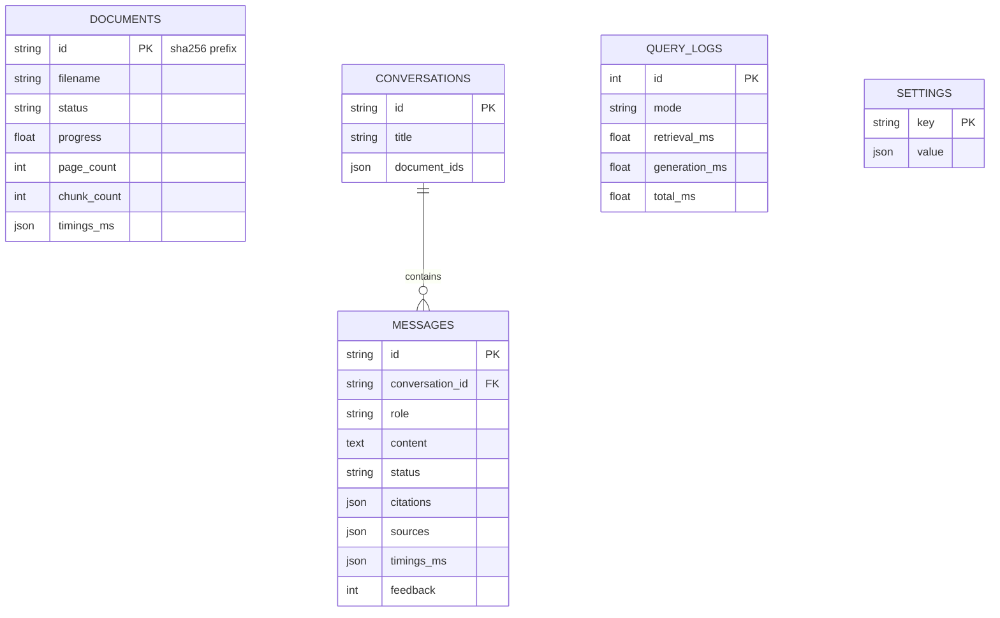

# Architecture

**Project:** QueryDoc AI · **Author:** Raahul Sallagunta

QueryDoc AI is a local-first, single-machine application: a React single-page app talks to
a FastAPI service that owns the RAG engine (PyMuPDF → chunking → SentenceTransformer
embeddings → FAISS → hybrid retrieval + reranking → local Hugging Face LLM → citation
verification). Nothing leaves the machine after the one-time model download.

## 1. System overview



| Layer | Location | Responsibility |
|---|---|---|
| Presentation | `frontend/src/pages`, `components`, `features` | Pages, design system, interaction, accessibility |
| Client data | `frontend/src/services/queries.ts`, `lib/api.ts`, `lib/sse.ts`, `hooks/use-chat-stream.ts` | Server state cache, polling, SSE parsing, optimistic updates |
| HTTP | `backend/app/api/v1/*`, `app/schemas/api.py`, `app/core/errors.py` | Routing, validation, error contract, timeouts, CORS, request ids |
| Application services | `backend/app/services/*` | Document lifecycle, conversation scoping/history, settings validation, analytics |
| Background work | `backend/app/workers/ingestion.py` | Bounded thread pool for PDF processing with progress |
| Engine bridge | `backend/app/rag/engine.py` | Owns the single `QueryDocService`, applies runtime settings, model status |
| Persistence | `backend/app/models`, `app/db`, `backend/alembic` | Documents, conversations, messages, settings, telemetry |
| RAG engine | `backend/querydoc/*` | Ingestion, chunking, embeddings, FAISS, retrieval, generation, citations, evaluation |

## 2. Frontend architecture



- **Routing:** `/` overview, `/library`, `/chat`, `/chat/:conversationId`, `/documents/:documentId?page=&q=`, `/analytics`, `/settings`. Heavy pages (PDF.js, Recharts) are code-split with `React.lazy`.
- **State:** server state lives in TanStack Query (`services/queries.ts`); UI state stays local (`useState`) or in `localStorage` (theme, sidebar and evidence-panel collapse). No global store is needed.
- **Streaming:** `useChatStream` POSTs to `/chat/stream`, parses SSE from `fetch`'s `ReadableStream` (`lib/sse.ts`), and holds `{phase, question, text, sources, error}`. On `meta` a new conversation's URL is set; on `done` the verified message is written into the cached conversation and the cache is invalidated. `AbortController.abort()` implements **Stop**.
- **PDF viewer:** `react-pdf` renders one page at a time on a canvas with a text layer; the PDF.js worker parses off the main thread. Search scans `getTextContent()` per page. Citation highlighting marks only text-layer spans whose text lies inside the verified passage, and only when the page actually contains it; otherwise the UI says so instead of guessing.
- **Design system:** CSS variables (OKLCH graphite neutrals, indigo-violet accent, status colours, chart palette) in `src/index.css`, consumed by Tailwind v4 `@theme`; dark is the default (`html.dark`), light is complete; `prefers-reduced-motion` disables transitions; focus rings use `:focus-visible`.

## 3. Backend architecture



- **Lifespan** (`app/main.py`): run Alembic migrations → open SQLite (WAL) → build `EngineManager` → apply persisted settings → reconcile DB with the FAISS index (import, re-queue interrupted jobs, mark missing) → optional background model warm-up.
- **Event loop discipline:** synchronous endpoints run in Starlette's threadpool; CPU work (PDF parsing, embeddings) runs in the ingestion pool; generation runs in a dedicated thread per stream. Nothing heavy executes on the event loop.
- **Production-style build:** when `frontend/dist` exists, FastAPI also serves the SPA (static assets + client-route fallback), so one process serves UI and API (`scripts/start_prod.sh`).

## 4. Document ingestion sequence

```mermaid
sequenceDiagram
    autonumber
    participant UI as React (Library)
    participant API as POST /documents/upload
    participant DB as SQLite
    participant W as IngestionWorker
    participant E as QueryDocService
    UI->>API: multipart files (XHR with upload progress)
    API->>API: size limit while streaming, .pdf, %PDF magic, sha256 → id, duplicate?
    API->>DB: insert document(status=queued) and commit
    API->>W: submit(id)
    API-->>UI: 202 {documents, errors}
    loop every 0.8 s while busy
      UI->>API: GET /documents (TanStack Query polling)
    end
    W->>DB: status=processing
    W->>E: ingest(bytes, progress=cb)
    E->>E: PyMuPDF pages → clean → chunk → embed → FAISS add (write lock) → atomic save
    E-->>W: progress(stage, fraction)
    W->>DB: stage/progress (throttled)
    W->>DB: status=ready, pages, chunks, timings
    UI->>UI: card shows Ready; polling stops
```

## 5. Question answering (SSE) sequence

```mermaid
sequenceDiagram
    autonumber
    participant UI as React (Chat)
    participant API as POST /chat/stream
    participant DB as SQLite
    participant T as worker thread
    participant G as GenerationGate
    participant E as QueryDocService
    UI->>API: {message, conversation_id?, document_ids}
    API->>DB: validate scope, create conversation + user message (history for follow-ups)
    API-->>UI: event: meta
    API->>T: start
    T->>G: acquire slot (≤1 active, ≤8 queued, 120 s) or 429-coded error
    T->>E: answer_stream(question, cfg, history, cancel)
    E-->>T: ("retrieval", passages)
    T-->>API: queue.put (call_soon_threadsafe)
    API-->>UI: event: retrieval → evidence panel fills
    loop tokens
      E-->>T: ("token", text)
      API-->>UI: event: token → streaming bubble
    end
    E-->>T: ("final", verified response)
    T->>DB: assistant message + citations + telemetry
    API-->>UI: event: done
    Note over UI,API: UI aborts → is_disconnected / CancelledError → cancel.set() →<br/>StoppingCriteria stops generation; message saved as "cancelled"
```

## 6. Data and storage

| Store | Content | Safety |
|---|---|---|
| `data/workspace/querydoc.db` (SQLite, WAL) | documents (lifecycle, timings), conversations, messages (citations, sources, timings, feedback), settings, query telemetry | Alembic-managed schema; FK cascade for messages |
| `data/workspace/index/` | `index.faiss`, `chunks.jsonl`, `manifest.json` (model, dim, counts, SHA-256) | atomic directory swap; validated on load; no pickle |
| `data/workspace/documents/<id>.pdf` | stored PDFs for viewing | path built only from a validated hex id |
| `data/workspace/uploads/` | uploads awaiting indexing | removed after success or validation failure |
| `data/workspace/embedding_cache/` | text-hash → vector (`.npz`) | `allow_pickle=False` |
| `~/.cache/huggingface` | model weights | loaded `local_files_only` first |



## 7. Concurrency model

- **FAISS index:** writer-preferring readers–writer lock — concurrent searches, exclusive add/delete/save.
- **Tokenizers:** short per-model locks (HF fast tokenizers are not re-entrant).
- **GPU (MPS):** one process-wide re-entrant lock per accelerator shared by embedder, reranker and LLM (two threads submitting Metal work crashed the process).
- **Generation admission:** `GenerationGate` taken at the start of a generating request (before retrieval) → bounded queue and timeout over the whole request; overflow returns `generation_queue_full` (429).
- **Ingestion:** `ThreadPoolExecutor(max_workers=1)` by default; embedding happens outside the index lock so questions keep working during uploads; a document can only have one job at a time.
- **Database:** short sessions per unit of work; SQLite WAL + busy timeout for the worker thread and request threads.

## 8. Security boundaries

| Boundary | Control |
|---|---|
| Upload → server | streamed size limit, extension + magic-byte checks, PyMuPDF open/encryption checks, page limit |
| Filenames | sanitised for display only; never used as filesystem paths |
| Ids in URLs | validated 16-hex / 32-char ids before any lookup |
| Document text → LLM | delimited untrusted `<source>` blocks, defused delimiters, instruction-like sentences redacted, rules in the system prompt |
| LLM output → user | citations validated against retrieved chunks, allowed scope and the index; support scored; status badge |
| Browser → API | CORS restricted to configured origins; no cookies or credentials; local single-user only |
| Persistence | no pickle; checksummed index; migrations |

**Not provided:** authentication, authorisation, per-user isolation, rate limiting per client, TLS. The app must not be exposed beyond localhost.

## 9. Deployment shapes

| Mode | Command | Processes |
|---|---|---|
| Development | `./scripts/dev.sh` | uvicorn :8000 + Vite :5173 (HMR, `/api` proxied) |
| Production-style local | `./scripts/start_prod.sh` | one uvicorn serving built SPA + API on :8000 |
| Tests | `./scripts/test_all.sh` | pytest (TestClient), Vitest (jsdom), Playwright (own server on :8300) |

Docker Compose is intentionally not provided: the models rely on the host's Apple GPU (MPS), which containers on macOS cannot use.
