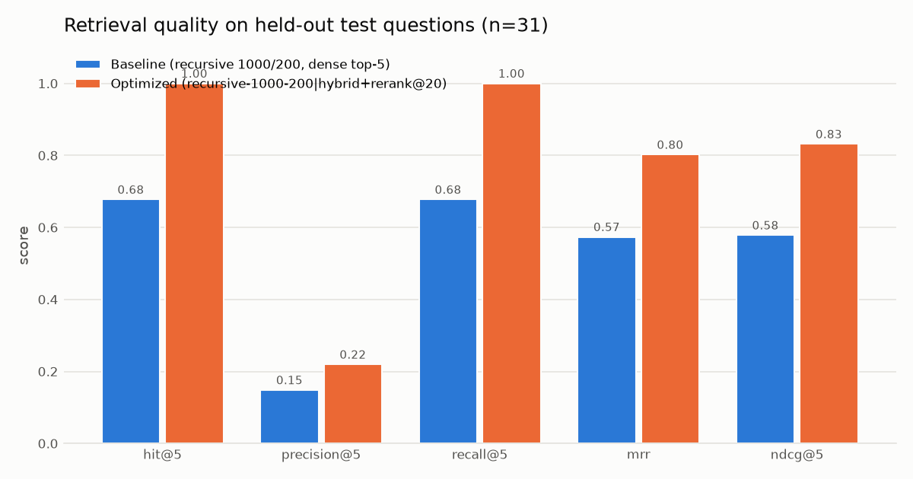
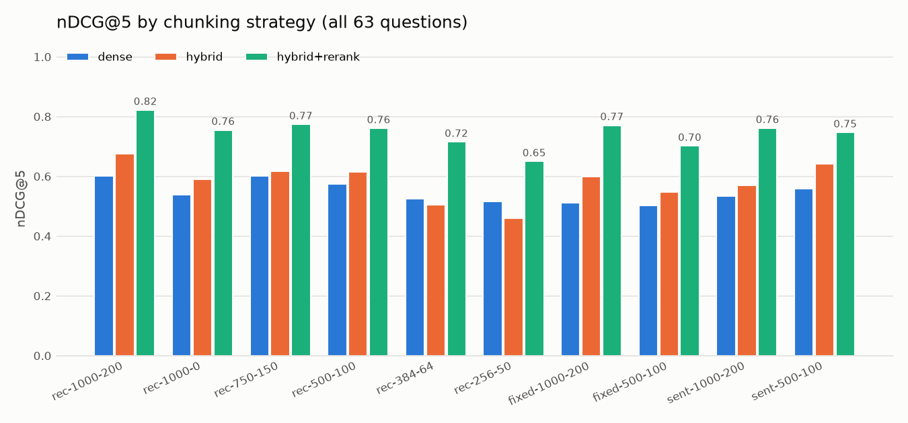
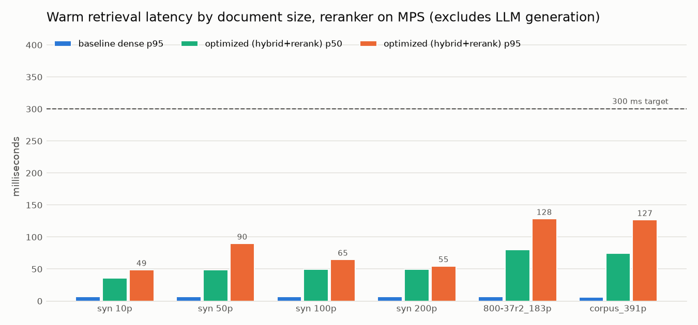
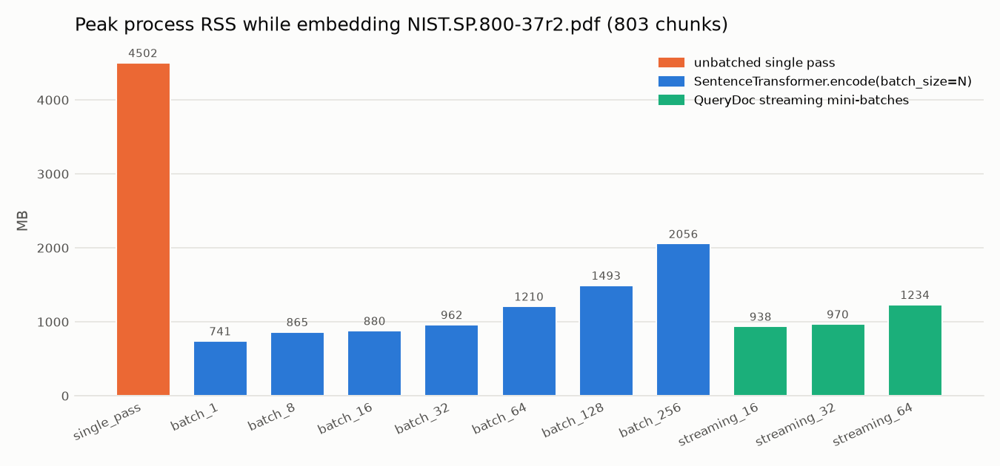
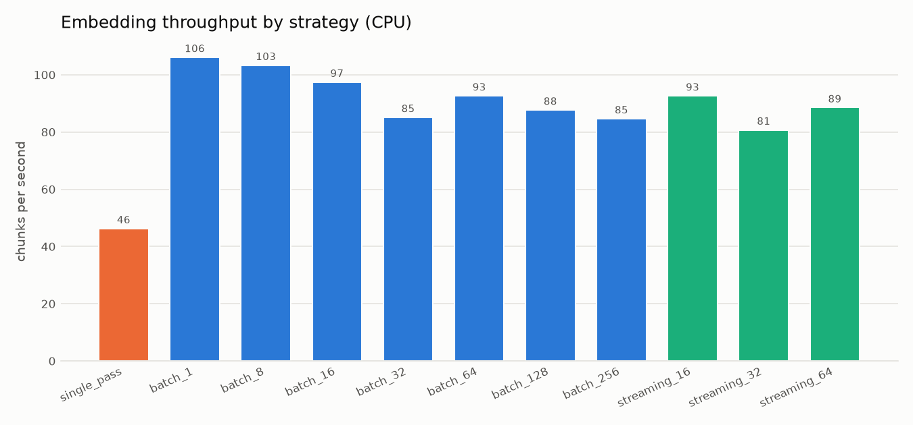
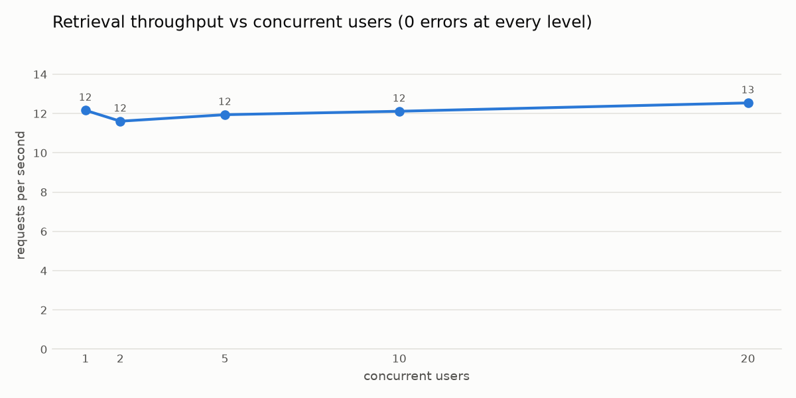
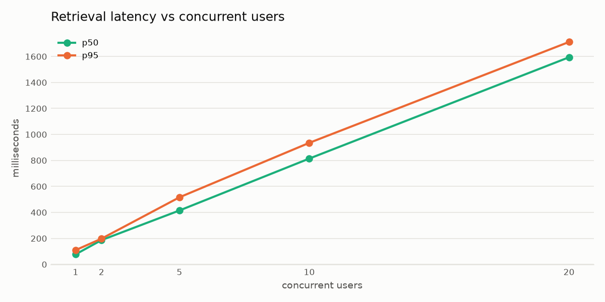

# Performance Report

**Project:** QueryDoc AI · **Author:** Raahul Sallagunta

All figures are measured, and each one points to its raw result file. Detailed
per-experiment tables and the unsuccessful approaches are in `docs/EXPERIMENTS.md`.

## 1. Environment

| | |
|---|---|
| Hardware | Apple MacBook Pro, M3 Pro (11 CPU cores, integrated GPU via Metal/MPS), 18 GB unified RAM |
| OS | macOS 26.5 |
| Python / PyTorch | 3.12.7 / 2.14.1 (CPU + MPS) |
| Key packages | transformers 5.20.1, sentence-transformers 6.1.0, faiss-cpu 1.15.1, PyMuPDF 1.27, langchain-text-splitters, streamlit 1.66 |
| Embedding model | `sentence-transformers/all-MiniLM-L6-v2` @ `1110a24` (CPU, 4 torch threads) |
| Reranker | `cross-encoder/ms-marco-MiniLM-L-6-v2` @ `233902d` (MPS by default) |
| LLM | `Qwen/Qwen2.5-1.5B-Instruct` @ `989aa79` (default) and `Qwen2.5-0.5B-Instruct` @ `7ae5576`, fp16 on MPS |
| Background load | 6.7–9.9 GB of swap in use when runs started (browsers were open); disk 99% full |

Exact versions, git commit, RAM available and swap are recorded in every `results/*/results.json → environment`.

**Caveat.** This is one laptop under real background load, not an isolated benchmark machine. Treat the
latency numbers as representative of a busy developer laptop. Tail latencies in particular were affected by
swapping.

## 2. Headline results

| Claim area | Result | Target | Verdict | Evidence |
|---|---|---|---|---|
| Context relevance (nDCG@5, held-out test) | 0.578 → 0.831, **+43.8%** (95% CI +16.6 … +90.6%) | ≥ +40% | PASS (test split); **+36.7% on all 63 questions** | `results/relevance/results.json` |
| Retrieval latency, 100+ page docs, warm, GPU reranker | p50 ≤ 80 ms, **p95 ≤ 129 ms** | p95 < 300 ms | PASS | `results/retrieval_latency/results.json` |
| Retrieval latency, CPU-only reranker | p50 245–274 ms, **p95 541–556 ms** on real docs | p95 < 300 ms | FAIL (CPU-only) | `results/retrieval_latency_cpu/results.json` |
| Embedding peak RSS, batched streaming vs unbatched | 4,502 → 970 MB, **−78.5%** | ≥ 35% | PASS | `results/embeddings/results.json` |
| …vs a batch-256 encode | 2,056 → 970 MB, −52.8% | — | info | same |
| …vs SentenceTransformers' default batch 32 | no difference (+0.8%) | — | info | same |
| Concurrent retrieval | 1–20 users, 380 requests, **0 errors**, ~12 req/s (serialised on the reranker) | tested | PASS | `results/concurrency/results.json` |
| Concurrent generation | 0 errors up to 5 users; at 10–20 users back-pressure rejects as designed, plus 7 timeouts | — | partial | same |
| End-to-end answer latency (1.5B, warm) | p50 1.9 s, p95 4.4 s | — | info (not sub-300 ms) | `results/generation/results.json` |

## 3. Retrieval quality

Baseline: recursive 1000/200 chunks, dense MiniLM, FAISS top-5.
Optimized (chosen automatically on the dev split): same chunks + BM25/dense RRF fusion + overlap de-duplication + cross-encoder reranking of the top 20.

| Split | Metric | Baseline | Optimized | Relative | Absolute |
|---|---|---|---|---|---|
| test (31) | nDCG@5 | 0.578 | 0.831 | +43.8% | +25.3 pts |
| test | Hit@5 | 0.677 | 1.000 | +47.6% | +32.3 pts |
| test | MRR | 0.574 | 0.802 | +39.8% | +22.8 pts |
| dev (32) | nDCG@5 | 0.622 | 0.811 | +30.3% | +18.9 pts |
| all (63) | nDCG@5 | 0.601 | 0.821 | +36.7% | +22.0 pts |
| all | Hit@5 | 0.730 | 0.968 | +32.6% | +23.8 pts |




What drives the gain: cross-encoder reranking (+20 nDCG points), then hybrid lexical retrieval (+2 on top of
reranking). MMR and small chunks made results worse.

## 4. Latency

Warm retrieval, 200 queries × 3 trials per cell; LLM generation excluded.

| Dataset | pages | chunks | dense p50 | optimized p50 (GPU) | optimized p95 (GPU) | optimized p95 (CPU) |
|---|---|---|---|---|---|---|
| synthetic | 100 | 216 | 6.0 ms | 49 ms | 65 ms | 167 ms |
| synthetic | 200 | 431 | 6.5 ms | 50 ms | 55 ms | 159 ms |
| NIST SP 800-37r2 | 183 | 803 | 6.2 ms | 80 ms | **129 ms** | **556 ms** |
| NIST corpus (4 PDFs) | 391 | 1532 | 5.9 ms | 75 ms | **127 ms** | **541 ms** |



Stage breakdown, NIST corpus, GPU reranker (mean): query embedding 5 ms · FAISS 0.2 ms · BM25+RRF 1.8 ms ·
dedup 7 ms · **rerank 71 ms**. On CPU the rerank stage alone is ~298 ms. The cold first query (lazy
initialisation) took 188–216 ms and is reported separately.

**End-to-end answers are not sub-300 ms.** With Qwen2.5-1.5B on MPS a full answer took p50 1.9 s / p95
4.4 s (time to first token p50 0.96 s, ~18 tokens/s). The 0.5B model is faster (p50 0.53 s) but much less accurate.

## 5. Memory

Embedding SP 800-37r2 (803 chunks) on CPU, fresh process per run, 3 repetitions:

| Strategy | Peak RSS (MB) | Embedding working set (MB) | chunks/s |
|---|---|---|---|
| unbatched single pass | 4502 | 3734 | 46 |
| batch 256 | 2056 | 1287 | 85 |
| batch 128 | 1493 | 724 | 88 |
| batch 32 (library default) | 962 | 205 | 85 |
| **QueryDoc streaming 32** | **970** | **203** | 81 |
| batch 1 | 741 | 33 | 106 |




Attribution: the reduction comes entirely from **bounding batch size**, since attention activations grow
with batch × seq². QueryDoc's wrapper matches the library default rather than beating it. Memory rises
monotonically with batch size, and larger batches were not faster on this CPU.

Other memory facts:
- FAISS flat index for the full corpus: 1,532 × 384 × 4 B ≈ 2.4 MB (the app reports 1.6 MB for its 2-document index).
- Steady-state app process RSS with two documents indexed: ~460 MB. The LLM's weights sit in GPU/unified memory and are not fully counted in RSS (~3 GB fp16 for 1.5B).

## 6. Concurrency

One shared service, Python threads, closed loop; full NIST index (4 documents, 1,532 chunks).

**Retrieval (optimized pipeline, 10 requests per user):**

| Users | Requests | Errors | req/s | p50 | p95 | p99 | Peak RSS |
|---|---|---|---|---|---|---|---|
| 1 | 10 | 0 | 12.2 | 77 ms | 110 ms | 126 ms | 1140 MB |
| 2 | 20 | 0 | 11.6 | 187 ms | 198 ms | 200 ms | 1143 MB |
| 5 | 50 | 0 | 11.9 | 415 ms | 516 ms | 523 ms | 1161 MB |
| 10 | 100 | 0 | 12.1 | 814 ms | 935 ms | 972 ms | 1169 MB |
| 20 | 200 | 0 | 12.5 | 1594 ms | 1711 ms | 1751 ms | 1174 MB |




Concurrent queries are **safe** (0 errors, no index corruption, memory flat) but **not parallel**: throughput
is capped at ~12 req/s by the single cross-encoder, which runs under one lock on the GPU. Latency therefore grows
linearly with users. Dense-only retrieval (~6 ms) would scale much further.

**Generation (Qwen2.5-1.5B, 64 new tokens, max 1 active, queue 8, timeout 120 s, 2 requests per user):**

| Users | Requests | OK | Rejected (queue full) | Timed out | p50 | p95 |
|---|---|---|---|---|---|---|
| 1 | 2 | 2 | 0 | 0 | 2.2 s | 2.7 s |
| 2 | 4 | 4 | 0 | 0 | 2.2 s | 6.5 s |
| 5 | 10 | 10 | 0 | 0 | 2.7 s | 18.8 s |
| 10 | 20 | 14 | 3 | 3 | 21.7 s | 98.0 s |
| 20 | 40 | 13 | 23 | 4 | 37.3 s | 103.7 s |

- Up to 5 concurrent users all requests succeed; extra users simply wait in the queue.
- At 10–20 users the admission gate rejects the overflow immediately (`QueueFullError`), which is the intended back-pressure.
- **Unexplained:** at 10–20 users throughput collapsed from 0.45 to ~0.07 req/s and 7 admitted requests hit the 120 s timeout. That is far slower than serial ~2.2 s generations would predict. Swap was nearly full at the time, so memory thrashing is the likely cause, but this was **not root-caused**. 20 concurrent *generation* users are **not** claimed as supported.
- Two bugs were found and fixed by this benchmark: (1) the reranker and LLM both used MPS from different threads and the process aborted with a Metal assertion; a shared per-device lock fixed it. (2) Requests queued without bound on that lock before reaching the admission gate; the gate now wraps the whole request.

## 7. Generation quality (held-out test split, 31 answerable + 6 unanswerable questions)

| Model | Answer accuracy (keyword) | Answers with a verified citation | …tagged by the model itself | Cited chunk holds the gold evidence | Unanswerable declined | e2e p50 / p95 | tokens/s |
|---|---|---|---|---|---|---|---|
| Qwen2.5-0.5B | 48% | 65% | 6% | 42% | 5/6 | 0.53 / 1.07 s | 25.7 |
| **Qwen2.5-1.5B (default)** | **84%** | **97%** | **65%** | **71%** | 5/6 | 1.91 / 4.41 s | 18.2 |

Notes:
- "Verified citation" includes citations added by post-hoc alignment, where the system cites the retrieved chunk that best supports an untagged sentence. These are labelled `attributed` and kept separate from model-written tags.
- The one unanswerable question 1.5B "answered" was "Which programming language must be used to implement the AI RMF?"; it replied that the framework does not specify one, which is correct. 0.5B said "Python" (wrong, flagged as partially verified).
- Accuracy is keyword-based and coarse; see `results/generation/per_question.csv` for every answer.

## 8. Ingestion

| Document | pages | chunks | total | of which embedding |
|---|---|---|---|---|
| synthetic | 100 | 216 | 1.8 s | 1.45 s |
| synthetic | 200 | 431 | 3.5 s | 2.8 s |
| NIST SP 800-37r2 | 183 | 803 | 10.8 s | 9.2 s |

## 9. Reproduce

```bash
python scripts/download_corpus.py
python benchmarks/benchmark_relevance.py --reranker-device mps
python benchmarks/benchmark_retrieval.py                                   # GPU reranker
python benchmarks/benchmark_retrieval.py --reranker-device cpu --name retrieval_latency_cpu
python benchmarks/benchmark_embeddings.py --repeats 3
python benchmarks/benchmark_ingestion.py --repeats 3
python benchmarks/benchmark_concurrency.py --retrieval-requests 10 --generation-requests 2 --max-new-tokens 64
python benchmarks/benchmark_generation.py
python benchmarks/make_charts.py
```

## 10. Statistical limitations

- 63 evaluation questions over 4 documents; the relevance CI is wide (test +17% … +91%).
- Labels were authored with AI assistance; no second annotator.
- Latency trials ran on a shared, memory-pressured laptop; p95 trial-to-trial standard deviation was up to 30 ms on small datasets.
- Memory is RSS sampled at 5 ms (a lower bound on true peak); GPU memory is not measured.
- Generation quality metrics are automatic keyword checks.
